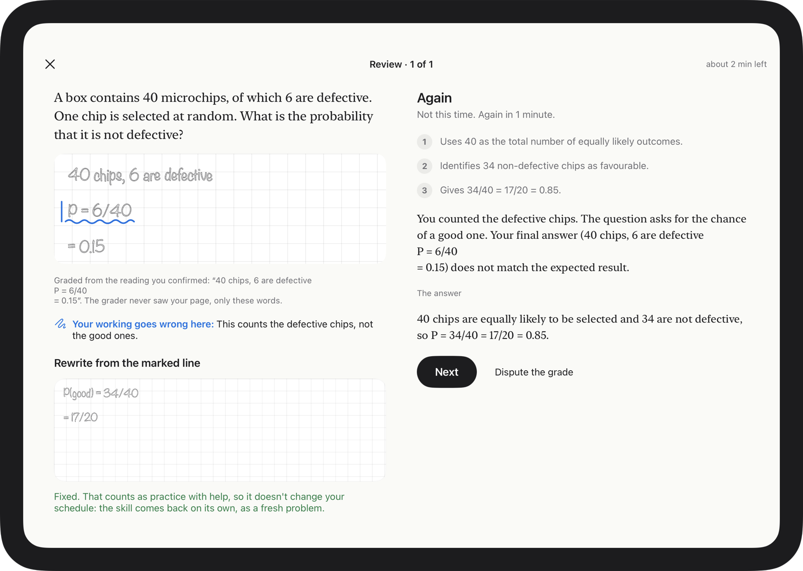
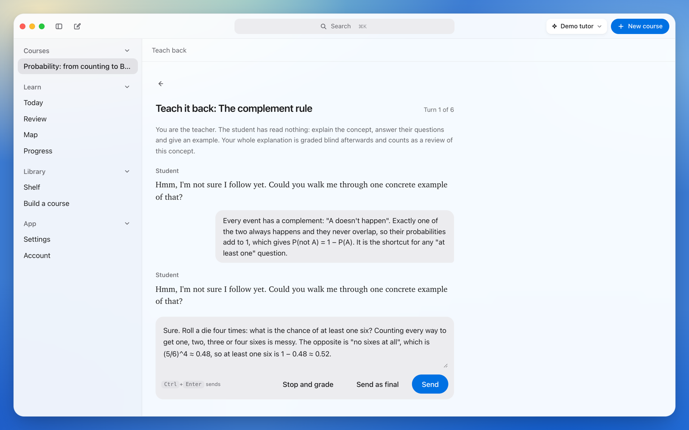
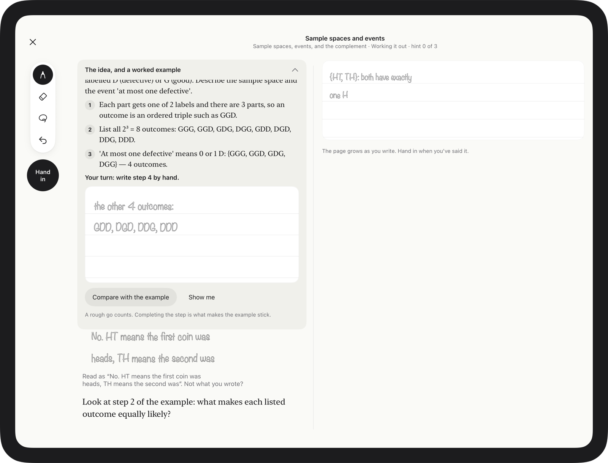
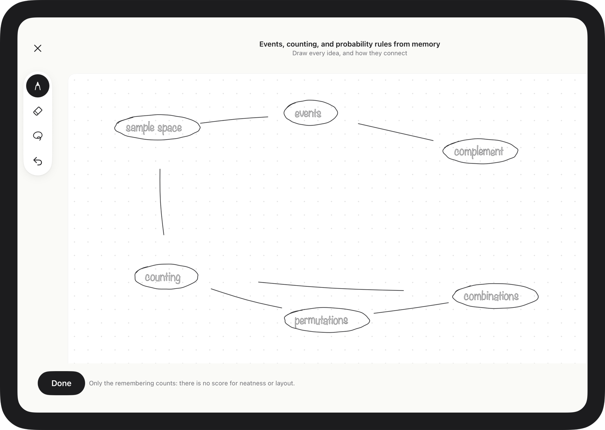
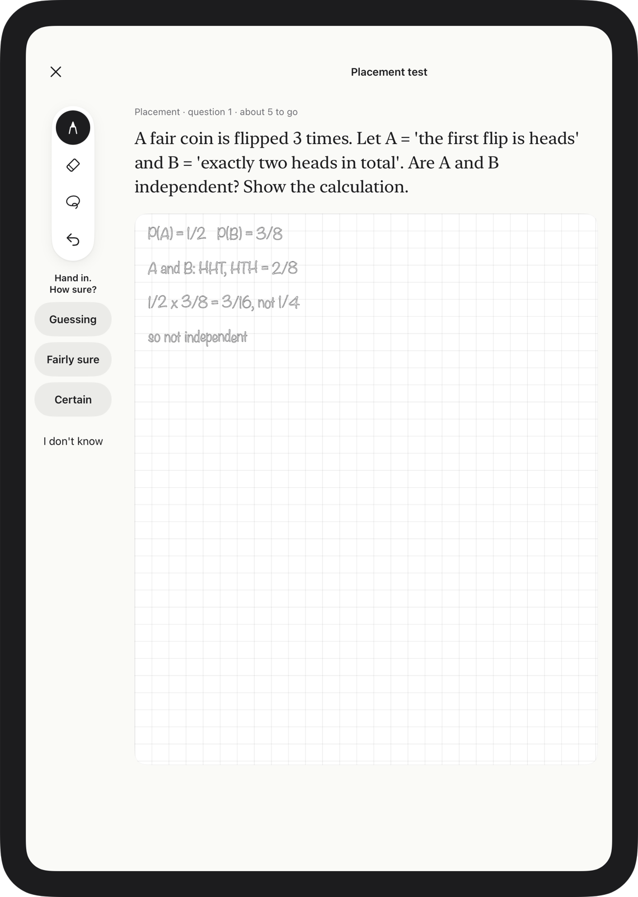
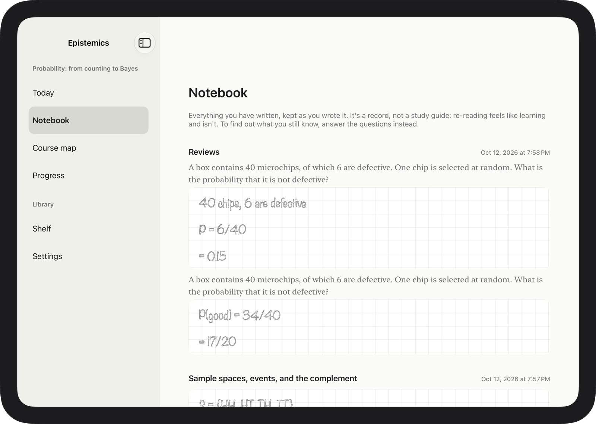
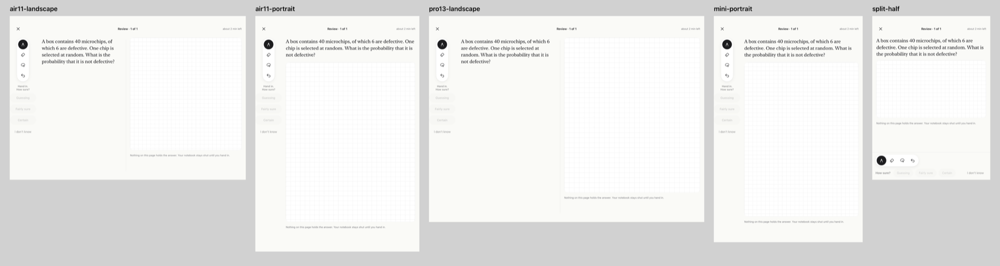

<h1 align="center">Epistemics</h1>

<p align="center"><b>Learning how to learn.</b><br>
Structured courses, taught Socratically by an AI tutor, with spaced retrieval enforced before anything new is taught.</p>

<p align="center">
  
  
</p>
<p align="center"><sub>Left: the web and desktop app. Right: the iPad app, where every answer is written by hand.</sub></p>

---

Most study apps optimise for the feeling of learning: re-reading, highlighting, a tutor that hands you the answer. Epistemics is built around the things that actually make knowledge stick:

- **You try before you're taught.** Every lesson opens with a question you can't answer yet, because a failed attempt makes the explanation land.
- **The tutor asks; it doesn't tell.** Hints come on a ladder, and the rule against giving answers lives in code, not in prompt wording.
- **Reviews come first.** A memory model (FSRS-6) schedules each idea just before you'd forget it, and the next lesson stays locked until today's reviews are done.
- **"Learned" means proven.** An idea counts as mastered only after unaided, mixed retrievals on separate days, never because you finished the lesson.
- **Questions change.** Reviews serve fresh versions of each problem, so passing means the skill rather than remembering one answer.

## Two apps, one way of learning

| | What it is | Status |
|---|---|---|
| **[Web and desktop](web)** | One React app, in the browser and as a Tauri desktop app. You type your answers. Local-first, with optional sync. | Built and tested. [Read more →](web/README.md) |
| **[iPad](ipad)** | A native SwiftUI app where every answer is written or drawn with Apple Pencil, because writing by hand makes retrieval harder and learning stick. | Built; runs in the iPad simulator. [Read more →](ipad/README.md) |

They share the course format and the bundled course (`web/content/packs`), the prompts (`web/content/prompts`), and the learning design ([web/docs/DESIGN.md](web/docs/DESIGN.md)) with its evidence base ([web/docs/research](web/docs/research)). They don't share code.

### The web app

<table>
  <tr>
    <td width="50%"><br><sub><b>A lesson.</b> The tutor asks; you answer in your own words.</sub></td>
    <td width="50%"><br><sub><b>A review.</b> Graded blind against a rubric, criterion by criterion.</sub></td>
  </tr>
  <tr>
    <td><br><sub><b>The course map.</b> Every idea, prerequisites to the left, coloured by how well you know it.</sub></td>
    <td><br><sub><b>Teach-back.</b> Explain the idea to a student who has read nothing.</sub></td>
  </tr>
</table>

### The iPad app

<table>
  <tr>
    <td width="50%"><br><sub><b>A lesson, in landscape.</b> The concept and a worked example on the left; your page on the right. You finish the last step of the example by hand.</sub></td>
    <td width="50%"><br><sub><b>Map from memory.</b> Draw every idea in a unit and how they connect, then see what you left out.</sub></td>
  </tr>
  <tr>
    <td><br><sub><b>The placement test.</b> A short adaptive test, by hand, that skips the lessons you don't need.</sub></td>
    <td><br><sub><b>The notebook.</b> Everything you've written, kept as you wrote it.</sub></td>
  </tr>
</table>

## Design

Both apps follow the same rule: **nothing on the screen may hold the answer to the question being asked.** Help is on the page while you're being taught and folded away while you answer alone.

- **Web:** a macOS-style window on a blurred colour wallpaper. All the colour lives behind the UI, the interface itself stays neutral, and the one saturated element on a screen is the action you take. See the [design system](web/docs/DESIGN-SYSTEM.md).
- **iPad:** the screen is paper. The serif is the material you're learning, graphite is your ink, and blue belongs to the tutor and nothing else. In portrait it's a single notebook page; in landscape it opens like a notebook, the question on one page and your writing on the other. See the [iPad design](ipad/docs/DESIGN.md).

<p align="center">
  
  <br><sub>One writing page, five windows: 11-inch landscape and portrait, 13-inch, iPad mini, and Split View. The paper keeps a fixed width and scales to fit, so rotating never moves your ink.</sub>
</p>

## Try it

**Web** (Node 22+, pnpm 10):

```bash
cd web && pnpm install && pnpm dev
```

Then open http://localhost:5173. It starts with a demo tutor that needs no API key; add an Anthropic key in Settings for the real one.

**iPad** (Xcode 27, iPadOS 27 simulator): open `ipad/Epistemics.xcodeproj` and run the **Epistemics** scheme on an iPad simulator. Details in [ipad/README.md](ipad/README.md).

## Where to read more

| | |
|---|---|
| [web/docs/DESIGN.md](web/docs/DESIGN.md) | The learning design: the lesson loop, scheduling, mastery, grading |
| [web/docs/research](web/docs/research) | The evidence behind each choice |
| [ipad/docs/DESIGN.md](ipad/docs/DESIGN.md) | How the iPad app reads handwriting and what each session looks like on paper |
| [ipad/docs/RESEARCH.md](ipad/docs/RESEARCH.md) | The evidence on handwriting and drawing, including where it doesn't support the idea |
| [ipad/docs/AUDIT.md](ipad/docs/AUDIT.md) | The design measured against Khan Academy, ALEKS, Math Academy and the research |
| [ipad/docs/UX-AUDIT.md](ipad/docs/UX-AUDIT.md) | Every iPad screen at five sizes, and what each orientation is for |
