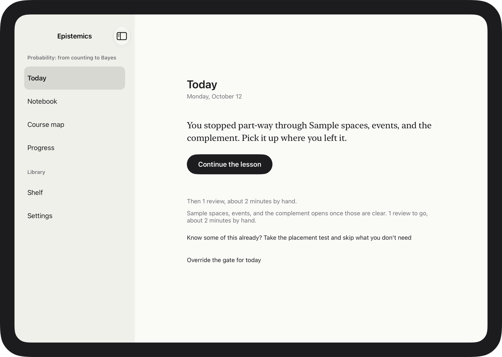
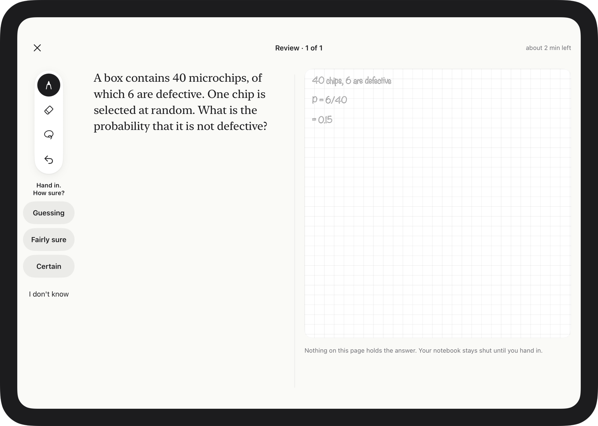

# Epistemics for iPad

**Structured courses where every answer is written by hand.**

The Epistemics course loop (Socratic lessons, spaced reviews, unaided checks) on an iPad, with Apple Pencil. Writing an answer is slower and harder than typing it, and that effort is what makes it stick. The app reads your handwriting, grades it blind, and marks your own page in blue.

<p align="center">
  
</p>

The web and desktop app is in [`../web`](../web). The two share the course format, the prompts and the learning design, but no code.

## A tour

<table>
  <tr>
    <td width="50%"><br><sub><b>Today.</b> One next step, said once. Reviews come before the next lesson.</sub></td>
    <td width="50%"><br><sub><b>A review.</b> The paper says what kind of answer is expected: squared for working, ruled for explaining, dotted for drawing. Handing in is saying how sure you are.</sub></td>
  </tr>
  <tr>
    <td><br><sub><b>The first wrong line, marked.</b> The grader names where your working goes wrong, the line gets a wavy blue underline, and you rewrite from there before the answer is shown.</sub></td>
    <td><br><sub><b>Map from memory.</b> Draw every idea in a unit and how they connect. It's compared with the course's own graph.</sub></td>
  </tr>
  <tr>
    <td><br><sub><b>The placement test.</b> A short adaptive test, by hand, on the course's prerequisite graph. It skips the lessons you already know.</sub></td>
    <td><br><sub><b>The notebook.</b> Everything you've written, kept as you wrote it: a record, not a study guide.</sub></td>
  </tr>
</table>

## What it does

- **Every answer by hand.** PencilKit, Pencil only (a finger scrolls). The tools and hand-in sit on the side of the hand you don't write with, and there's a left-handed layout.
- **Reading ink.** An on-device draft first, then the Claude Reader, which never sees the answer key. You confirm the reading when it matters, the grader sees only the confirmed words, and its marks land on your own strokes.
- **Lessons.** Try before you're taught, then a Socratic dialogue. While help is allowed, the concept and a worked example sit beside the page; the example fades, leaving the last steps for you to write.
- **Reviews.** Spaced by FSRS-6, gated before new lessons, and served as a fresh version of each problem each time. A wrong answer with working gets its first wrong line marked and a chance to fix it before the answer is shown.
- **Mastery that has to be earned.** Only unaided answers on mixed, unlabelled questions count. Progress checks every few lessons send back whatever slipped.
- **Also:** a warm-up recall, checkpoint papers, maps from memory, teach-back, the notebook, the course map and progress.

## Design

**The screen is paper.** The serif is the material you're learning, graphite is your ink, and blue belongs to the tutor and nothing else. Nothing on the screen may hold the answer to the question being asked: help is on the page while you're being taught and folded away while you answer alone.

**One writing page, every window.** In portrait it's a single notebook page with the question pinned above your paper. In landscape it opens like a notebook, the material on one page and your writing on the other. In Split View the controls move to the bottom. The paper keeps a fixed width and scales to fit, so rotating the iPad never moves your ink.

<p align="center">
  
</p>

| Read more | |
|---|---|
| [docs/DESIGN.md](docs/DESIGN.md) | What the app is, how it reads ink, each session, the item types on paper, the architecture |
| [docs/RESEARCH.md](docs/RESEARCH.md) | The evidence on handwriting, drawing and reading ink, including where it does *not* support the idea |
| [docs/AUDIT.md](docs/AUDIT.md) | The design measured against Khan Academy, Khanmigo, ALEKS, Math Academy and the evidence |
| [docs/UX-AUDIT.md](docs/UX-AUDIT.md) | Every screen at five iPad sizes, what each orientation is for, and the layout work that followed |

## Build, run and test

Needs Xcode 27 with the iPadOS 27 simulator.

```bash
open Epistemics.xcodeproj
```

Run the **Epistemics** scheme on an iPad simulator. The tutor starts as an offline demo; Settings takes a Claude API key (kept in the Keychain) or the URL of a proxy that holds one (`web/apps/server`). In the simulator a pointer can draw; on a device only Apple Pencil does, unless Settings → "Let a finger draw too" is on.

Debug builds have Settings → Developer: run the clock ahead a day, let the demo tutor finish the next lesson, open a unit's checkpoint or map directly, and make the demo grader mark a wrong answer's first line so "Fix it" can be seen without a key.

Tests:

```bash
cd EpistemicsKit && swift test
```

```bash
xcodebuild -project Epistemics.xcodeproj -scheme Epistemics -destination 'platform=iOS Simulator,name=iPad Air 11-inch (M4)' test
```

Regenerate the README screenshots (real views and app state, with a scripted tutor and generated handwriting):

```bash
TEST_RUNNER_EPISTEMICS_SCREENSHOTS=1 xcodebuild -project Epistemics.xcodeproj -scheme Epistemics -destination 'platform=iOS Simulator,name=iPad Air 11-inch (M4)' -only-testing:EpistemicsTests/ScreenshotTests test
```

When the web core changes, regenerate the parity fixtures from the repository root:

```bash
node ipad/Tools/export-conformance.mjs
```

### Layout

```
Epistemics.xcodeproj
Epistemics/          the app (SwiftUI): App, Design, Ink, Reading, Store, Services, Screens
EpistemicsTests/     app tests: storage, layout at real iPad sizes, the recogniser, end-to-end session flows
EpistemicsKit/       Swift package, no UIKit
  EpistemicsCore     port of web/packages/core: FSRS-6, the review gate, mastery, the lesson state machine,
                     placement and progress checks (API: Sources/EpistemicsCore/API.md)
  EpistemicsLLM      port of web/packages/llm, plus the Reader (API: Sources/EpistemicsLLM/API.md)
Tools/export-conformance.mjs   regenerates the parity fixtures from the TypeScript core
```

The scheduling and lesson logic is a line-for-line Swift port of the web core, checked against fixtures exported from the real TypeScript.

## Not yet done

- **Never run against the real Claude API from this machine.** The Anthropic provider is covered by request and streaming tests, and every flow is tested end to end with the demo tutor.
- **Only tested in the simulator,** not with a real Apple Pencil.
- **The hosted tutor** (the Supabase edge function) needs account sign-in, which isn't built. Use a key or a proxy.
- **No maths recogniser** (Mathpix, MyScript): handwritten maths is read by the Claude Reader from the image.
- **Not built:** sync, building courses on the iPad, the typed-versus-ink experiment, and the notebook's "try it first".
