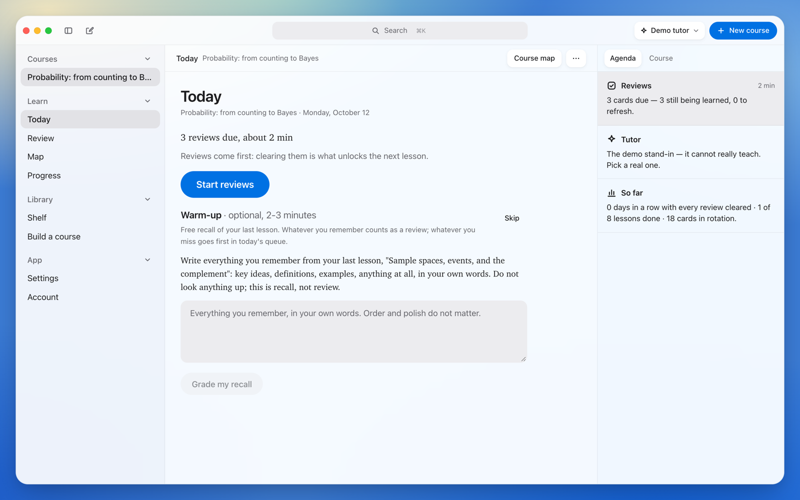
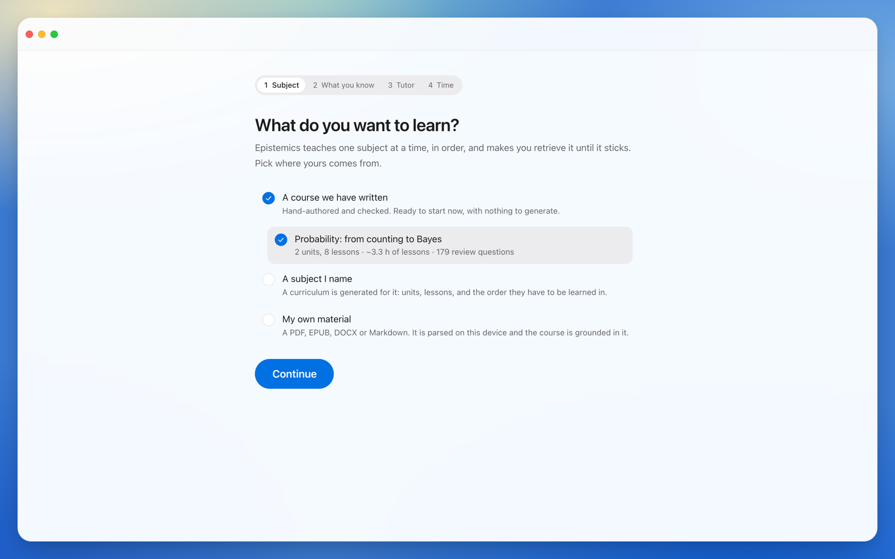
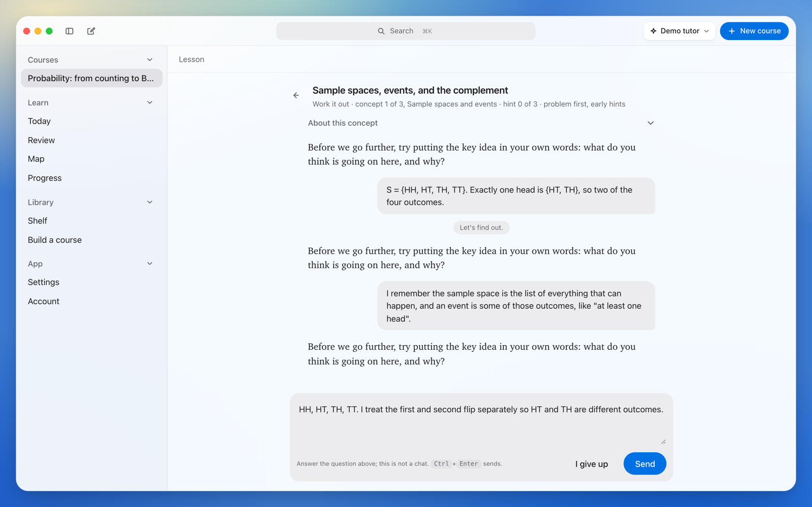
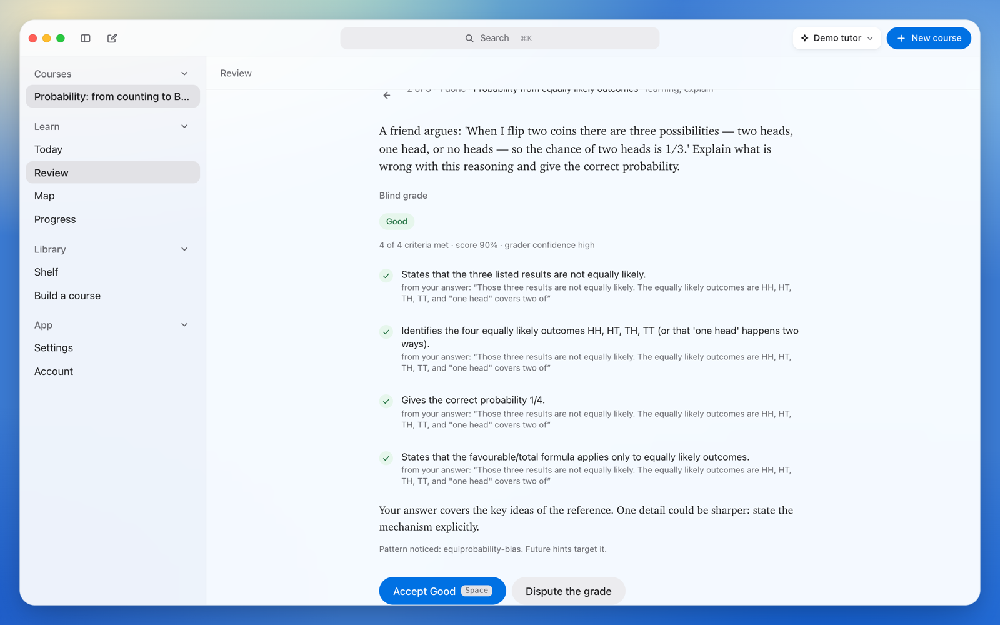
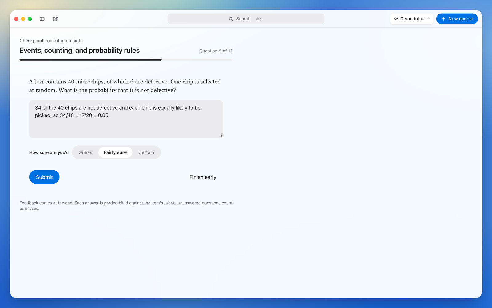
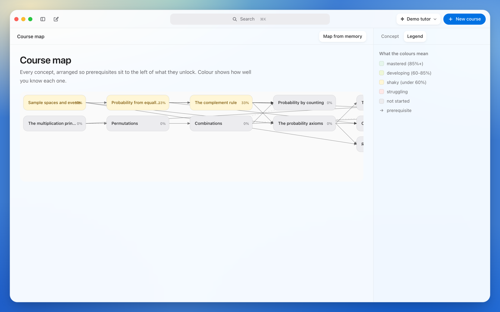
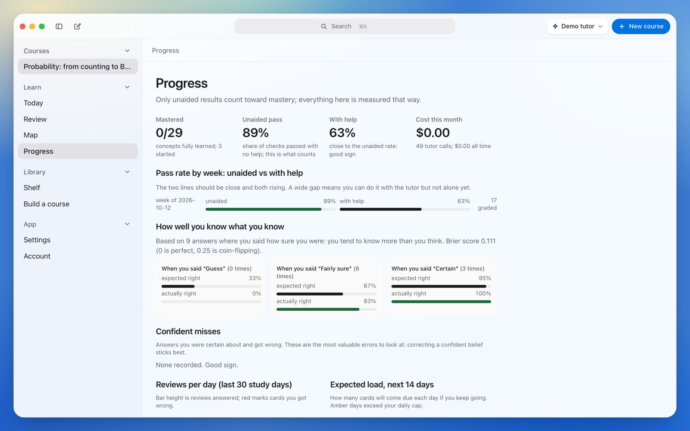

# Epistemics for web and desktop

**Learning how to learn.** A local-first app, in the browser and on the desktop, that turns a subject or your own material into a structured course, teaches it Socratically with an AI tutor, checks you without help at every step, and makes you review before it lets you learn anything new.

<p align="center">
  
</p>

Its iPad sibling, where every answer is handwritten, is in [`../ipad`](../ipad).

## A tour

<table>
  <tr>
    <td width="50%"><br><sub><b>Pick what to learn.</b> The bundled probability course, a subject to generate, or your own PDFs and notes.</sub></td>
    <td width="50%"><br><sub><b>A lesson.</b> It opens with a question you can't answer yet, then the tutor leads you to the idea with questions, not answers.</sub></td>
  </tr>
  <tr>
    <td><br><sub><b>Reviews.</b> Graded blind against a rubric, with the evidence quoted from your answer. You can dispute a grade.</sub></td>
    <td><br><sub><b>Checkpoints.</b> A mixed paper at the end of each unit, no help, with a confidence rating on every answer.</sub></td>
  </tr>
  <tr>
    <td><br><sub><b>The course map.</b> Every idea, arranged so prerequisites sit to the left of what they unlock.</sub></td>
    <td><br><sub><b>Progress.</b> Unaided against with-help pass rates, calibration, and the answers you were sure of and got wrong.</sub></td>
  </tr>
</table>

## How it teaches

- **Retrieve before you're taught, and again after.** Every lesson runs PRIME → PROBE → DEVELOP → CONSOLIDATE → EXTEND → CHECK → WRAP, starting with an attempt and ending with an unaided check.
- **The tutor asks; it doesn't tell.** Hints come on a ladder, and withholding the answer is enforced by a state machine and a leak detector, not by prompt wording.
- **Reviews are scheduled and gated.** FSRS-6 spaces every review, and the next lesson stays locked until today's reviews are done (you can override that once a day).
- **Mastery takes three spaced successes** without help, on separate days.
- **Curricula are generated once,** checked, versioned and shelved for reuse: outline → concepts → prerequisite graph → lesson scripts → review items → a self-check.

The full design is in [docs/DESIGN.md](docs/DESIGN.md), with the evidence in [docs/research](docs/research).

## Design

**All the colour lives behind the UI.** The window sits on a blurred wallpaper of cream, jade, sky and cobalt, and the interface itself stays neutral, so the one saturated thing on a screen is the action you take. **Nothing is drawn that space can do instead:** no boxes, no rules between rows, no status chips repeating what a sentence already says. Screens read like a conversation, in one column, with the tutor's voice in a serif.

See [docs/DESIGN-SYSTEM.md](docs/DESIGN-SYSTEM.md) for the tokens, components and rules, and [docs/UX-AUDIT.md](docs/UX-AUDIT.md) for the screen-by-screen audit.

## Run it

Needs Node 22+ and pnpm 10.

```bash
pnpm install
pnpm dev
```

The web app opens on http://localhost:5173, on the first run ([docs/ONBOARDING.md](docs/ONBOARDING.md)): pick what to learn, say what you already know, pick a tutor, and say how much time you have most days. It ends on Today with a lesson ready.

**Choosing a tutor** (also in Settings afterwards):

- **Demo:** the default. No key, works offline, deterministic. It can't really teach, but every flow works.
- **Anthropic, with your key:** stored in the browser and sent straight to the API.
- **Anthropic through a proxy:** run `ANTHROPIC_API_KEY=... pnpm --filter @epistemics/server dev` and the app talks to `/api/anthropic`, with a daily budget.
- **Ollama:** a local model at `http://localhost:11434`, at reduced quality.

**Desktop** (needs Rust and the Tauri system libraries, see [apps/desktop/README.md](apps/desktop/README.md)):

```bash
pnpm tauri dev
```

**Sync between devices** (optional): create a Supabase project, apply `supabase/migrations`, and enter the project URL and anon key on the Account screen. See [supabase/README.md](supabase/README.md) and [docs/SYNC.md](docs/SYNC.md).

## Test it

```bash
pnpm -r --if-present typecheck
```

```bash
pnpm -r --if-present test
```

```bash
pnpm --filter @epistemics/web e2e
```

The end-to-end tests run in Playwright's Chromium (`pnpm exec playwright install chromium` once). To regenerate the README screenshots, build the app, then run the opt-in screenshot spec from `apps/web`:

```bash
pnpm --filter @epistemics/web build
```

```bash
cd apps/web && EPISTEMICS_SCREENSHOTS=1 pnpm exec playwright test screenshots
```

## What's inside

| Package | |
|---|---|
| `packages/core` | The scheduler (FSRS-6), the review queue and its gate, concept mastery and prerequisites, the lesson state machine, checkpoints, the diagnostic, teach-back. Pure TypeScript. |
| `packages/llm` | Anthropic, Ollama and mock providers; the tutor, observer, blind grader, teach-back student and answer-leak detector; versioned prompts; a usage ledger and budget guard. |
| `packages/architect` | The curriculum pipeline, with content-hash caching, prerequisite-graph checks and verified problem variants. |
| `packages/ingest` | PDF, EPUB, DOCX and Markdown parsing, chunking and embeddings. |
| `packages/db`, `packages/platform` | Drizzle schema and repositories; SQLite in Node, in the browser (sqlite-wasm on OPFS) and in Tauri. |
| `packages/sync`, `supabase/` | Optional cross-device sync, last writer wins per row; an edge function that can hold the API key. |
| `apps/web` | The React app: Today, lessons, reviews, checkpoints, teach-back, the course map, the shelf, progress and settings. |
| `apps/desktop` | The Tauri 2 shell. The API key lives in the OS keychain and never enters the web view. |
| `apps/server` | A small proxy for the browser build, with a per-day budget. |
| `content/` | The hand-authored probability course (2 units, 8 lessons, 29 concepts, 179 review items, every numeric answer machine-checked) and the prompt files. |

More: [docs/ONBOARDING.md](docs/ONBOARDING.md) (the first run), [docs/PLAN.md](docs/PLAN.md) (the phased plan), [docs/SYNC.md](docs/SYNC.md) (the sync protocol).
